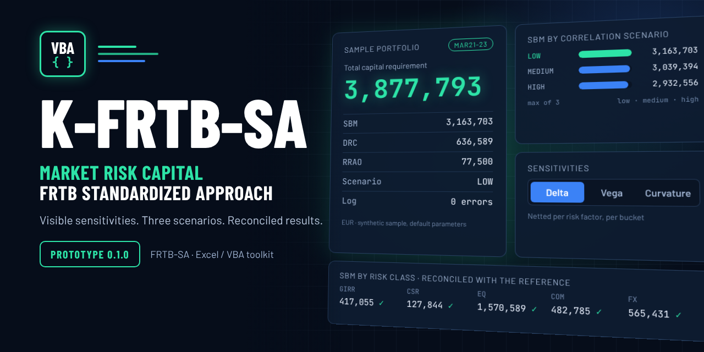

<div align="center">

# 📈 K-FRTB-SA

### FRTB standardized approach for market risk in Excel VBA

**Basel MAR21-MAR23 · Sensitivities-based method · Default risk charge · Residual risk add-on · Reconciled with an independent reference · No real portfolio data**

<br>

[](#quick-start)
[](#quick-start)
[](docs/methodology.md)
[](#status)
[](docs/validation.md)
[](docs/validation.md#not-validated)
[](LICENSE)

<br>

[](https://github.com/danielep71/MKT-FTRB-SA/commits)
[](https://github.com/danielep71/MKT-FTRB-SA/issues?q=is%3Aissue%20is%3Aopen%20label%3AP1)
[](https://github.com/danielep71/MKT-FTRB-SA/issues?q=is%3Aissue%20is%3Aopen%20label%3AP2)
[](https://github.com/danielep71/MKT-FTRB-SA/issues?q=is%3Aissue%20is%3Aopen%20label%3AP3)
[](https://github.com/danielep71/MKT-FTRB-SA/stargazers)

<br>

**No add-in · No external reference · No DLL · No installer · Reviewable source for every calculation**

[Quick start](#quick-start)
&nbsp;·&nbsp;
[How a run works](#how-a-run-works)
&nbsp;·&nbsp;
[Workbook](#workbook)
&nbsp;·&nbsp;
[Validation](#validation)
&nbsp;·&nbsp;
[Limitations](#limitations)
&nbsp;·&nbsp;
[Methodology](docs/methodology.md)
&nbsp;·&nbsp;
[Scope](docs/SCOPE.md)

---

<p align="center">
  
</p>

---

</div>

<a id="status"></a>

> [!IMPORTANT]
> **Version 0.1.0 is a prototype** of the
> [v0.1.0 - SA prototype](https://github.com/danielep71/MKT-FTRB-SA/milestone/2)
> milestone (issue #20). It implements the Basel standardized approach
> (MAR21-MAR23) in Excel VBA with parameters checked against the BIS text,
> and every output is reconciled with an independent Python reference. It has
> **not yet been compiled or run in Excel**, the engine platform decision is
> still open ([scope](docs/SCOPE.md#platform-and-environment)), and no result
> is validated for regulatory use ([validation](docs/validation.md)).

> [!NOTE]
> The macro-enabled workbook is **not stored in the repository**.
> `tools/Build-Workbook.ps1` builds it from the macro-free template
> `src/workbook/FRTB_Template.xlsx` and the exported VBA in `src/modules`, and
> the template itself is generated from those modules, so every line of
> calculation code and every default parameter is reviewable in a pull request.

## ✨ What this project is

**FRTB-SA** supports transparent implementation, benchmarking and validation
of the **Fundamental Review of the Trading Book standardized approach**. The
standardized approach sets the own-funds requirement for market risk as the
sum of three parts:

```text
Capital = SBM + DRC + RRAO
SBM     = max over {low, medium, high} correlation scenarios of
          sum over risk classes of (delta + vega + curvature)
```

**K-FRTB-SA** is the workbook prototype. You enter sensitivities and
positions; the engine nets them per risk factor, applies the risk weights and
correlations of each bucket, aggregates across buckets under three correlation
scenarios and writes every intermediate result. It is built for market risk
practitioners, model developers, validators, researchers and educators who
need to **check** an FRTB-SA number:

- each bucket's `Kb` and `Sb`, the curvature scenario chosen and every use of
  the alternative `Sb` are visible on `Out_Buckets`;
- each obligor's net jump-to-default and each bucket's hedge benefit ratio are
  visible on `Out_DRC`;
- every rejected input row is listed on `Log` with the reason, never counted
  as zero;
- every parameter sits on an editable `P_*` sheet next to its MAR paragraph,
  and one that is missing or not a number stops the run instead of becoming
  zero.

| Area | Status |
| --- | --- |
| Label catalogue, reconciliation, and drift detection | Implemented |
| Repository protection and security baseline | Configured; remaining dependencies tracked in issue #2 |
| Universal integrity gate | Implemented; required-check enforcement tracked in #2 |
| Sensitivities-based method (SBM) | Prototype: GIRR, CSR non-securitization, equity, commodity, FX; delta, vega, curvature |
| Default risk charge (DRC) | Prototype: non-securitizations |
| Residual risk add-on (RRAO) | Prototype |
| Independent benchmarks and runtime evidence | Python reference reconciled with the VBA run in LibreOffice; Excel evidence pending |

---

## 🎯 Core capabilities

| Area | Capability |
| --- | --- |
| Risk classes | GIRR, CSR non-securitization, equity, commodity, FX |
| SBM measures | Delta, vega and curvature; netting per risk factor; other-sector buckets without diversification |
| Correlation scenarios | Low, medium and high for every `rho` and `gamma` (squared for curvature); SBM = max of the three totals |
| Discretions | sqrt(2) for specified GIRR currencies and FX pairs (with first-order crosses), FX curvature divisor 1.5 |
| DRC | Non-securitization JTD, maturity scaling, obligor netting by seniority, hedge benefit ratio per bucket |
| RRAO | Exotic (1.0%) and other (0.1%) residual risks |
| Input validation | Unknown risk classes, buckets, tenors, sub-types, ratings and seniorities, non-numeric amounts (text numbers are read in one locale-independent form, see the [workbook guide](docs/workbook-guide.md#numbers)) and the reporting currency as an FX bucket are rejected and logged; invalid parameters stop the run |
| Parameters | Eight `P_*` sheets with MAR references, checked against the BIS Basel Framework on 2026-10-17 |
| Testing | Hand-calculated formula tests, an independent Python reference, headless LibreOffice runs of the VBA, an in-workbook regression test and a static VBA lint |
| Deployment | Plain exported VBA; no add-in, COM component, DLL or extra VBA reference |

---

<a id="quick-start"></a>

# ⚡ Quick start

## 1. Clone and check

Prototype work integrates on **`release/v0.1.0`**; setup work stays on
`release/v0.0.1`. See [branch governance](docs/GOVERNANCE.md).

```sh
git clone --branch release/v0.1.0 https://github.com/danielep71/MKT-FTRB-SA.git
cd MKT-FTRB-SA
python3 tools/vba_lint.py
```

Use a clone, not **Download ZIP**: a clone checks the VBA out with the CRLF
line endings the VBA editor expects. The full test suite needs LibreOffice
and Python packages; see [validation](docs/validation.md). Maintenance checks are described in [Installation](INSTALLATION.md) and
[Repository checks](docs/CI.md); they include labels, configuration,
whitespace and local documentation targets.

## 2. Build the workbook

1. In Excel, enable **Trust access to the VBA project object model**.
2. From the repository root, in PowerShell:

   ```powershell
   powershell -ExecutionPolicy Bypass -File tools\Build-Workbook.ps1 -RunTests
   ```

3. Open `dist\K-FRTB-SA.xlsm`, then run **Debug → Compile VBAProject** in the
   VBA editor (**Alt+F11**).

`-Production` leaves out the test module; the manual import is described in
the [workbook guide](docs/workbook-guide.md#building-the-workbook-windows-excel).

## 3. Run

The workbook ships with a synthetic sample portfolio. On **Control**, click
**Run FRTB-SA**: Results, the `Out_*` sheets and Log are rewritten. Then click
**Run regression test**: `Test_Expected` compares 52 results with the values
of the independent reference and shows PASS or FAIL per item.

<a id="how-a-run-works"></a>

## 🔄 How a run works

```text
Control + P_*  ──►  load settings and parameters
In_Delta       ──►  validate, net per risk factor ──► WS = RW x s ──► Kb, Sb ──► across buckets ─┐
In_Vega        ──►  validate, net per risk factor ──► WS = RW x s ──► Kb, Sb ──► across buckets ─┼─► SBM per scenario
In_Curvature   ──►  validate, net per risk factor ──► CVR up/down ──► Kb, Sb ──► across buckets ─┘
In_DRC         ──►  JTD, maturity scaling, seniority netting ──► HBR ──► DRC per bucket
In_RRAO        ──►  gross notional x RW
                    ──►  Results, Out_Summary, Out_RiskClass, Out_Buckets, Out_DRC, Log
```

<a id="workbook"></a>

## 🗂️ Workbook

Every sheet carries the same frame: the product name in gold on a black bar,
the sheet title on a blue bar and a one-line subtitle. Tabs are colored by
role.

| Tab | Sheets | Content |
| --- | --- | --- |
| 🟦 Navy | `README` | In-workbook guide |
| 🟨 Gold | `Control`, `In_Delta`, `In_Vega`, `In_Curvature`, `In_DRC`, `In_RRAO`, `P_*` | Settings, inputs and parameters; cream cells are meant to be edited |
| 🔷 Blue | `Results`, `Out_Summary`, `Out_RiskClass`, `Out_Buckets`, `Out_DRC`, `Log` | Outputs, rewritten on every run |
| 🟩 Green | `Test_Expected` | Regression test of the sample portfolio |

<a id="validation"></a>

## 🧪 Validation

| Check | What it shows |
| --- | --- |
| VBA static lint | `Option Explicit`, module names and banners, no undeclared identifiers, no cross-module use of private procedures |
| Hand-calculated tests | The reference reproduces small examples worked from the MAR formulas, including the points confirmed against the BIS text |
| Parameter spot check | The `P_*` sheets equal an independently typed list of the regulatory values |
| VBA reconciliation | The VBA, run headless in LibreOffice, reproduces every output of the Python reference, with and without the discretions, and logs every invalid row |
| In-workbook regression | 52 items PASS |

Static checks, runtime execution, independent numerical comparison and
methodology review establish different things. The
[validation record](docs/validation.md) lists the commands and, explicitly,
what is **not** validated yet.

<a id="limitations"></a>

## ⚠️ Limitations

- Not compiled or run in Excel yet; LibreOffice's VBA support is not Excel's.
- CSR securitization (non-CTP and CTP) and securitization DRC are not
  implemented and are rejected.
- Sensitivities and CVRs are inputs: the workbook does not price instruments.
- The [interpretations](docs/methodology.md#interpretations-and-simplifications-to-review)
  listed in the methodology still need a decision.
- No regulatory compliance, verified capital calculation or production
  readiness is claimed. Keep examples and datasets synthetic: never submit
  client, counterparty, position or credential data.

## 📚 Documentation and project tracking

| Need | Start here |
| --- | --- |
| Formulas, parameters, BIS check, open interpretations | [Methodology](docs/methodology.md) |
| Source layout, build, sheets, inputs, running | [Workbook guide](docs/workbook-guide.md) |
| Automated checks and what is not validated | [Validation](docs/validation.md) |
| Local setup and verification commands | [Installation](INSTALLATION.md) |
| Source, tests, generated files, and evidence placement | [Repository structure](docs/REPOSITORY_STRUCTURE.md) |
| Universal maintenance CI and dependency updates | [Repository checks](docs/CI.md) |
| Aggregate traffic history and collection readiness | [Traffic history](docs/TRAFFIC_HISTORY.md) |
| Conduct and reporting | [Code of conduct](CODE_OF_CONDUCT.md) |
| Private security reporting | [Security policy](SECURITY.md) |
| Documentation index | [Documentation](docs/README.md) |
| Functional scope, platform decisions, and validation policy | [Scope](docs/SCOPE.md) |
| Setup work and proposed functional phases | [Roadmap](docs/ROADMAP.md) |
| Label usage, issue priorities, and metadata checks | [Labels and triage](docs/LABELS.md) |
| How to contribute | [Contributing](CONTRIBUTING.md) |
| Development branches and integration | [Governance](docs/GOVERNANCE.md) |
| Effective repository controls and outstanding settings work | [Settings baseline](docs/REPOSITORY_SETTINGS.md) |
| Recorded changes | [Changelog](CHANGELOG.md) |
| Prototype backlog | [v0.1.0 milestone](https://github.com/danielep71/MKT-FTRB-SA/milestone/2) |
| Setup backlog | [v0.0.1 milestone](https://github.com/danielep71/MKT-FTRB-SA/milestone/1) |
| Privately report a potential vulnerability | [Private vulnerability reporting](https://github.com/danielep71/MKT-FTRB-SA/security/advisories/new) |

Every issue must have **one priority label**, a milestone, and an assignee.
P1 is reserved for confirmed calculation bugs.

## 📜 Regulatory basis and evidence

The methodology follows the Basel Framework (MAR21-MAR23, in force since
1 January 2023) and keeps any jurisdiction-specific implementation separate.
Each implemented rule carries its paragraph reference; a link to a regulation
is not proof that an implementation matches it.
[Scope](docs/SCOPE.md#source-and-validation-policy) defines the source and
independent-validation policy.

Setup work is integrated on main; this prototype and its updated forms remain
on release/v0.1.0 until an owner-requested main integration. Repository setup
closeout is #8; prototype evaluation/closeout is #32. Traffic credentials and
first collection remain explicitly deferred in #23.

## 🏷️ Project name

The documentation uses **FRTB-SA**, with the standard acronym FRTB, and the
workbook is branded **K-FRTB-SA**. The GitHub repository identifier is
**MKT-FTRB-SA**, which transposes the letters in FRTB; it is retained for URL
and clone-path continuity.

## 📄 License

This project is distributed under the [MIT License](LICENSE).

Maintained by [Daniele Penza](https://github.com/danielep71).
